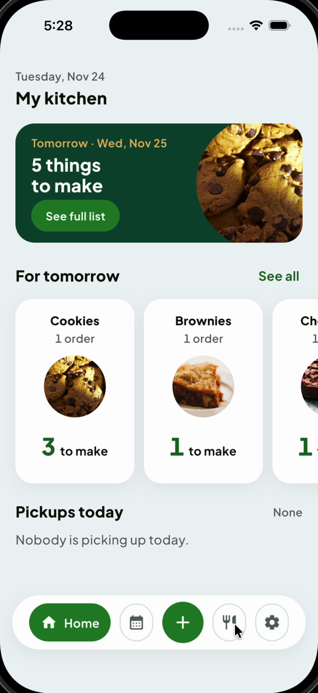
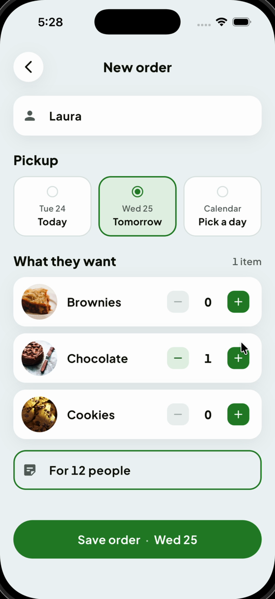
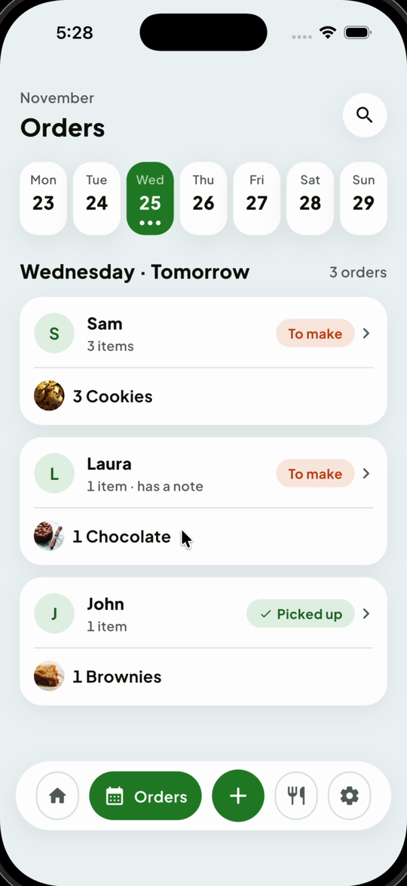

<div align="center">

<picture>
  <source media="(prefers-color-scheme: dark)" srcset="https://assets.appambit.com/logo-dark.svg">
  <source media="(prefers-color-scheme: light)" srcset="https://assets.appambit.com/logo-light.svg">
  
</picture>

<br><br>


# Foodmorrow — know today what you cook tomorrow (Flutter)

**For people who sell homemade food: log every order in seconds, see them by day, and open the app to see exactly
what to make tomorrow — everything added up. Database, Cloud Code and Analytics on [AppAmbit](https://appambit.com) —
no server of your own, no login.**

App **04 / 07** of the *7 apps in 7 days* series — built with **one prompt**.


[](https://www.facebook.com/profile.php?id=61583377906035)
[](https://www.instagram.com/appambit/)
[](https://www.youtube.com/@AppAmbit)

</div>

---

## Contents

- [What this is](#what-this-is)
- [Built with one prompt](#built-with-one-prompt)
- [Quick start](#quick-start)
- [Backend setup (AppAmbit)](#backend-setup-appambit)
- [How it is put together](#how-it-is-put-together)
- [What's included](#whats-included)
- [Make it yours](#make-it-yours)
- [Checks](#checks)
- [Demo data](#demo-data)
- [Learn more](#learn-more)
- [Follow AppAmbit](#follow-appambit)

## What this is

Orders for homemade food arrive all week by WhatsApp, Instagram and phone calls, and end up scattered across chats
and a notebook. The night before, the seller scrolls through everything and adds it up by hand. **Foodmorrow** turns
many small orders into one list:

- **Log an order in seconds:** customer, items from your menu, pickup day.
- **Orders by day,** with search, and a tap to mark each one as picked up.
- **Home answers one question:** *what do I make tomorrow?* — every order of the day, added up.
- **Your menu** with food photos; removing an item archives it, so old orders keep it.
- **No login, no notifications:** one phone is one seller.
- **Online only:** nothing is cached; a failure shows "No connection" with Retry.

<div align="center">

| Home | New order | Orders |
|:---:|:---:|:---:|
|  |  |  |
| *Tomorrow, added up.* | *An order in seconds.* | *Orders by day.* |

</div>

> Real captures from the iOS simulator. Design: **"Fresh Batch"** — a food app, not a spreadsheet. All approved screens in
> [`design/screens/`](design/screens/), the rules in [DESIGN.md](DESIGN.md).

## Built with one prompt

The whole app — backend, app, tests and a real run on two phones — was built with **one prompt** sent to a coding
agent (Claude Code) with the **AppAmbit MCP** connected. It's in **[`prompts.md`](prompts.md)**, ready to paste:

| Step | Where | What it builds |
|---|---|---|
| 0 | By hand | The two AppAmbit apps and their keys in `.env` |
| 1 | Agent + AppAmbit MCP + Flutter | Everything: backend, the app, tests, the real test on two phones |

No Firebase and no push credentials: Foodmorrow has no notifications.

## Quick start

**Prerequisites:** Flutter with Dart `^3.11`, Xcode and/or Android Studio, and an
[AppAmbit account](https://appambit.com) with **Database** and **Cloud Code** enabled.

```bash
git clone <your fork> foodmorrow && cd foodmorrow
cp .env.example .env     # fill in both App Keys
flutter pub get
flutter run
```

`.env` (git-ignored, never commit it):

```
APPAMBIT_IOS_APP_KEY=<your iOS app key>
APPAMBIT_ANDROID_APP_KEY=<your Android app key>
```

Branches: `main` = the Flutter scaffold, untouched · `dev` = all the work.

## Backend setup (AppAmbit)

Paste the prompt in [`prompts.md`](prompts.md) with the AppAmbit MCP connected and the agent creates all of this.

### Database — `FoodmorrowDb`

Linked to **both** apps, so the same seller sees the same orders on any phone. Run
[`cloud_functions/schema.sql`](cloud_functions/schema.sql) once: 4 tables, the day index, and a unique index so a
seller can't have the same menu item twice, however they type it.

> When running the DDL through the AppAmbit MCP, strip the `--` comments first: the tool's SQL guard rejects
> statements that carry them.

### Cloud Code

Five functions, HTTP trigger on both apps. Full contract and rules in
**[cloud_functions/README.md](cloud_functions/README.md)**.

| Function | Does |
|---|---|
| `hello` | Creates or updates the seller; called on every app start |
| `profile` | Business name and the first day of the week |
| `products` | The menu: list, add, edit, remove (archive) |
| `orders` | Week view, search, get, save, picked up, delete |
| `home` | Tomorrow's list, added up across every order, and today's orders |

- **One seller, their own rows.** Every statement is filtered by `seller_id`, with a test for each.
- **Dates come from the phone** (`today`, `tomorrow`); only timestamps come from the database clock.
- **An order and its items are written together** with `ctx.appambit.batch(..., true)`, so the app never reads half
  an order.
- `_shared.mjs` + `parts/<name>.mjs` are the source; run `node cloud_functions/make.mjs` to build the deployable
  files. Never edit `hello.mjs`, `profile.mjs`, `products.mjs`, `orders.mjs` or `home.mjs` by hand.

## How it is put together

```
lib/
├── main.dart            dotenv → AppAmbitSdk.start → hello → runApp
├── app.dart             the four tabs under the floating tab bar
├── core/                theme tokens, dates, the photo library, shared widgets,
│   └── appambit/        …and the only place that touches the AppAmbit SDK
└── features/            welcome · home · orders · menu · settings
                         views → controllers (ChangeNotifier) → repositories → core/appambit
```

No state-management package: controllers extend `ChangeNotifier` and views rebuild with `ListenableBuilder`. The
order rules live in `lib/features/orders/order_draft.dart` as plain Dart, so they are tested without widgets.

Four things that came out of running it for real:

- Cloud Code calls go out **one at a time** (`AppAmbitCloudService`). Four at once never come back.
- Only the tab you are looking at is built, so opening the app is one call, not four.
- **The first frame never waits on the network.** `hello` is started, not awaited; the shell picks it up when it
  lands.
- **Everything that loads shimmers** (`core/widgets/shimmer.dart`), in the shape of the content that is coming, so
  nothing jumps when it arrives. With "reduce motion" the placeholders stand still.

## What's included

| Area | Where |
|---|---|
| First open: what the app is for (shown once per phone) | `lib/features/welcome/` |
| Home: tomorrow's list and today's orders | `lib/features/home/` |
| Orders by day, search, new / edit, picked up | `lib/features/orders/` |
| Menu with food photos | `lib/features/menu/` |
| Settings: business card, week start, time zone, help | `lib/features/settings/` |
| AppAmbit Cloud Code, Analytics and diagnostics | `lib/core/appambit/` |
| Plus Jakarta Sans (OFL) and the food photo library (Unsplash License, see `assets/food/CREDITS.md`) | `assets/` |
| Cloud Code sources, schema and tests | `cloud_functions/` |

## Make it yours

- **App keys** — your own, in `.env`.
- **App name** — `ios/Runner/Info.plist` (`CFBundleDisplayName`) and `android/app/src/main/AndroidManifest.xml`
  (`android:label`).
- **Bundle id / applicationId** — `com.kavaup.foodmorrow` (change it with `dart run change_app_package_name:main
  <new.id>`).
- **Food photos** — add yours to `assets/food/` and list them in `lib/core/food_photos.dart`.

## Checks

```bash
flutter analyze                          # no issues
flutter test                             # 91 unit and widget tests
node --test cloud_functions/*.test.mjs   # 22 cloud tests against in-memory SQLite
```

Against the real backend, on a real device or simulator:

```bash
flutter test integration_test/real_run_test.dart -d <device>       # the whole app end to end
flutter test integration_test/screen_tour_test.dart -d <device>    # walks every screen slowly, for screenshots
flutter test integration_test/test_crash_test.dart -d <device>     # a test crash (the app goes down)
flutter test integration_test/seed_demo_data_test.dart -d <device> # fills the phone with the demo data
```

`real_run_test.dart` writes real rows for a throwaway seller and deletes its orders afterwards; it prints
`SELLER_ID=…` so the rest can be cleaned up.

## Demo data

To fill a phone with Ana's Kitchen — four menu items and a set of orders, so tomorrow adds up to 52 things to make:

```bash
flutter test integration_test/seed_demo_data_test.dart -d <device>
flutter run -d <device>
```

It writes through the app's own repositories, so everything lands in AppAmbit exactly as the app would put it there.
Run it again and it tops the data back up.

One catch on the iOS **simulator**: each install gets a fresh container, so the phone forgets which seller it was and
you land back on Welcome. On a real phone the seller sticks.

## Learn more

- [prompts.md](prompts.md) — the one prompt the app was built with
- [cloud_functions/README.md](cloud_functions/README.md) — every function's contract and the rules they keep
- [DESIGN.md](DESIGN.md) · [design/screens/](design/screens/) — the look
- [AGENTS.md](AGENTS.md) — rules for coding agents
- [AppAmbit](https://appambit.com) · [AppAmbit docs](https://docs.appambit.com) · [Flutter docs](https://docs.flutter.dev)

## Follow AppAmbit

New apps every week, built on AppAmbit with an AI agent:

- **Facebook** — [facebook.com/AppAmbit](https://www.facebook.com/profile.php?id=61583377906035)
- **Instagram** — [@appambit](https://www.instagram.com/appambit/)
- **YouTube** — [@AppAmbit](https://www.youtube.com/@AppAmbit)

---

<div align="center"><sub>Built with Flutter + AppAmbit. One prompt, a real app with a backend.</sub></div>
